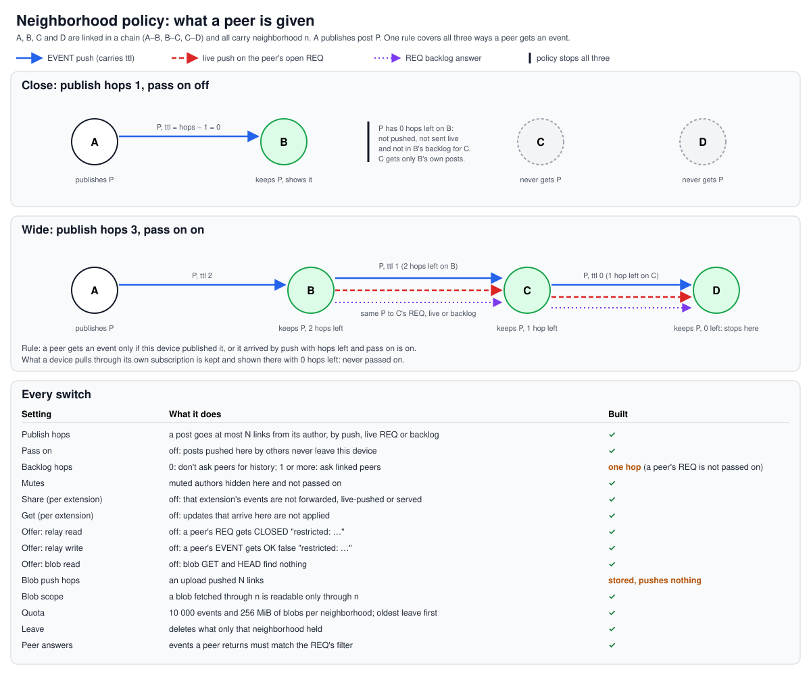

# Policy per neighborhood

How far traffic travels, set per neighborhood. Myco settings, not NAP
input: NAP-NEIGHBOR leaves reach to the runtime.

Code: `Policy` in `myco-core/src/neighbor/store.rs`, stored in
`neighborhoods.json`. Enforced in `myco-core/src/neighbor/data.rs` and
`service.rs`.

## Settings

| Setting | Default | Meaning |
| --- | --- | --- |
| Publish hops | 3 | How far a post travels |
| Backlog hops | 2 | Whether history is asked of peers (see below) |
| Pass on | on | Whether others' posts are passed on |
| Blob push hops | 0 | How far an upload is pushed (0: stays here) |
| Extensions: Get / Share | all on | Which updates are applied from here, and which this device sends here ([extensions.md](extensions.md)) |

`nearby` starts with its own: publish hops 1, pass on off
([proximity.md](proximity.md)).

## What a peer is given

A peer gets an event in three ways: a push (`EVENT`), a live push on its
open `REQ`, or a `REQ`'s backlog. All three follow one rule.

A peer gets an event only if:

- **this device published it** (a napplet's publish, or an update it
  shares), or
- **it arrived by push with hops left**, and **pass on** is on here.

Events pulled through a subscription are kept and shown here, with 0 hops
left. They are never passed on.

Also never given to a peer:

- an event by an author muted here;
- an event of an extension this device does not **Share** here.

The scope table (`neighborhood-scopes.json`, format 2) records, per event
and neighborhood, whether it was published here and how many hops it has
left. A format 1 file reads as everything pulled: nothing in it is passed
on.

## Reach presets

The neighborhood page shows reach as three presets:

| Posts reach | Publish / backlog hops | Pass on |
| --- | --- | --- |
| Close | 1 / 1 | off |
| Friends of friends | 2 / 1 | on |
| Wide (default) | 3 / 2 | on |

## Backlog hops

Only zero or not:

- **0:** a subscription reads what is kept here and asks no peer.
- **1 or more:** it also asks the linked peers carrying the neighborhood.

A peer answers from what it keeps. It never passes the `REQ` on, so
history comes from one hop away, whatever the number.

## Offer switches

What this side offers peers in a neighborhood is enforced on every
request:

| Offer | Off means |
| --- | --- |
| Relay read | A peer's `REQ` gets `CLOSED` `"restricted: …"` |
| Relay write | A peer's `EVENT` gets `OK false` `"restricted: …"` |
| Blob read | Blob `GET` and `HEAD` find nothing |

See [links.md](links.md#offers).

## Limits

- **Quota:** each neighborhood keeps up to 10 000 events and 256 MiB of
  blobs here. Past that, its oldest leave its scope.
- **Answers are checked:** events a peer returns must match the `REQ`'s
  filter, or they are dropped.
- **Leaving** a neighborhood deletes what only it held.

## Blob push hops

Stored, but pushes nothing. Links fetch blobs on demand
([data-plane.md](data-plane.md#blobs)).

## Mutes

Mutes are per author, per neighborhood. Muted authors' events are hidden
and not passed on.

## Default offer

A new neighborhood offers its own content both ways (relay read and write)
and blob reads. See [links.md](links.md#offers).
